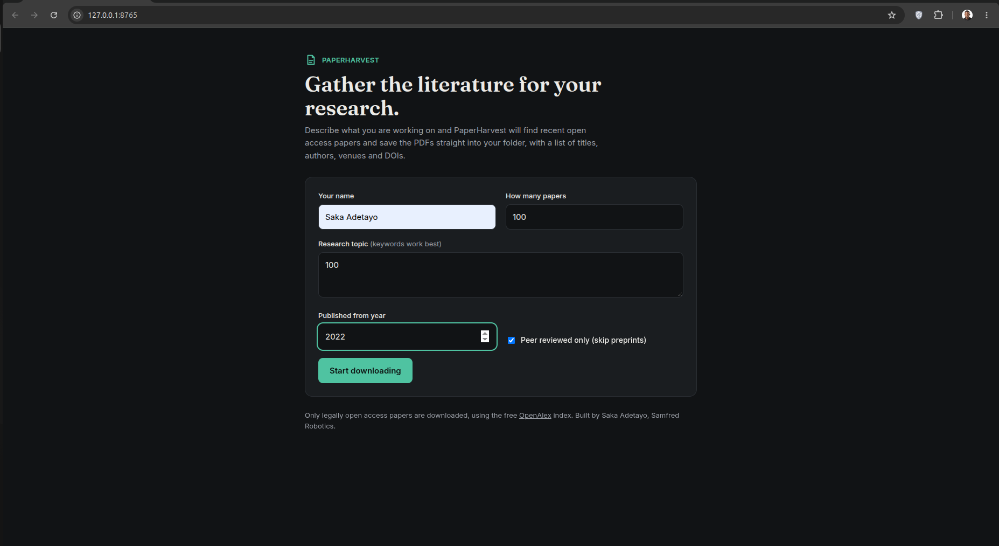

# PaperHarvest

Download recent open access research papers on any topic, straight into your folder, from a simple browser interface.

Type your name, describe your research, choose how many papers you want and the earliest publication year, then click **Start downloading**. PaperHarvest searches the free [OpenAlex](https://openalex.org) index (which covers IEEE, Elsevier, Springer, MDPI, Wiley, arXiv and many more), picks papers that have a legal open access PDF, and saves them for you.

It was first built to collect 100 recent papers for a UAV systems literature review, and it works for any field.



## Features

* Clean local web interface that opens in your browser
* Choose your topic, the number of papers and the starting year
* Option to keep only peer reviewed papers and skip preprints
* Live progress bar and download log, with a Stop button
* Files named clearly, for example `001 2024 Deep Reinforcement Learning for UAV Navigation.pdf`
* A `Paper List.csv` with title, authors, year, venue, citations and DOI for every paper, useful for reference managers and PRISMA reviews
* No installs: uses only the Python standard library

## Requirements

Python 3.8 or newer. Nothing else to install.

Check if you have it:

| System | Command |
|---|---|
| Linux / macOS | `python3 --version` |
| Windows | `python --version` |

If Python is missing:

* **Windows:** download it from [python.org/downloads](https://www.python.org/downloads/). During setup, tick **"Add Python to PATH"**.
* **macOS:** download it from [python.org/downloads](https://www.python.org/downloads/), or run `brew install python` if you use Homebrew.
* **Linux (Ubuntu/Debian):** `sudo apt install python3`

## Get the code

With Git:

```bash
git clone https://github.com/Adetayo224/PaperHarvest.git
```

Without Git: click the green **Code** button on this page, choose **Download ZIP**, and unzip it.

## Run it

Open a terminal in the folder where you want the papers saved, then run PaperHarvest from there.

### Linux

```bash
cd ~/path/to/your/research/folder
python3 ~/path/to/PaperHarvest/paperharvest.py
```

### macOS

Open **Terminal** (press Cmd + Space, type Terminal).

```bash
cd ~/path/to/your/research/folder
python3 ~/path/to/PaperHarvest/paperharvest.py
```

### Windows

Open **Command Prompt** or **PowerShell** (press the Windows key, type cmd).

```bat
cd C:\Users\YourName\Documents\MyResearch
python C:\Users\YourName\Downloads\PaperHarvest\paperharvest.py
```

If `python` is not recognised, try `py` instead:

```bat
py C:\Users\YourName\Downloads\PaperHarvest\paperharvest.py
```

Tip for Windows: in File Explorer, open your research folder, click the address bar, type `cmd` and press Enter. A terminal opens already inside that folder.

### Simplest option on any system

Put `paperharvest.py` and `index.html` inside your research folder, open a terminal there and run `python3 paperharvest.py` (Linux / macOS) or `python paperharvest.py` (Windows).

## Using it

Your browser opens at `http://127.0.0.1:8765`. If it does not open by itself, copy that address into your browser.

1. Enter your name.
2. Type your research topic as keywords, for example `UAV GNSS denied navigation`.
3. Choose how many papers you want and the earliest publication year.
4. Click **Start downloading** and watch the progress.

Papers are saved inside a `Papers` folder in whichever folder you ran the command from, grouped by topic:

```
your research folder/
  Papers/
    GNSS denied UAV navigation/
      001 2023 ....pdf
      002 2024 ....pdf
      Paper List.csv
```

Press `Ctrl+C` in the terminal to close it.

If port 8765 is busy, pick another port:

| System | Command |
|---|---|
| Linux / macOS | `PAPERHARVEST_PORT=8800 python3 paperharvest.py` |
| Windows (Command Prompt) | `set PAPERHARVEST_PORT=8800 && python paperharvest.py` |
| Windows (PowerShell) | `$env:PAPERHARVEST_PORT=8800; python paperharvest.py` |

## Tips for better results

* Use focused keywords, for example `federated learning UAV` instead of a full sentence.
* Run several searches, one for each section of your review. Each topic gets its own folder.
* If fewer papers arrive than you asked for, try broader keywords or an earlier start year.

## Limitations

PaperHarvest downloads **only open access papers**. It does not bypass paywalls. Papers behind subscriptions (many IEEE Xplore or ScienceDirect articles) are skipped, so get those through your library or institution.

## Contributing

Issues and pull requests are welcome.

## Author

Saka Adetayo Muhammed, Samfred Robotics, Ogbomoso, Nigeria
[Portfolio](https://adetayosaka.vercel.app/) · [YouTube](https://www.youtube.com/@samfred_robotics)

## License

MIT
